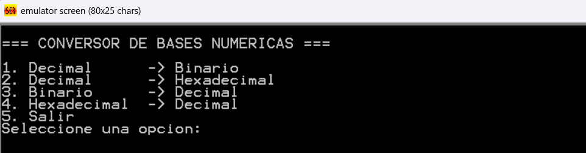
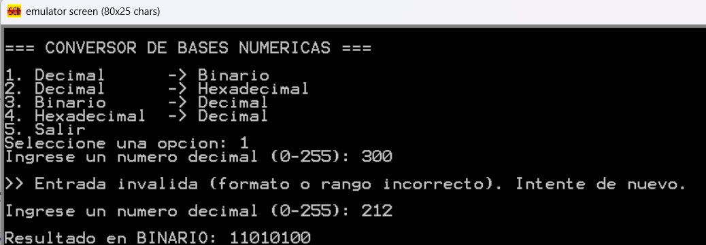
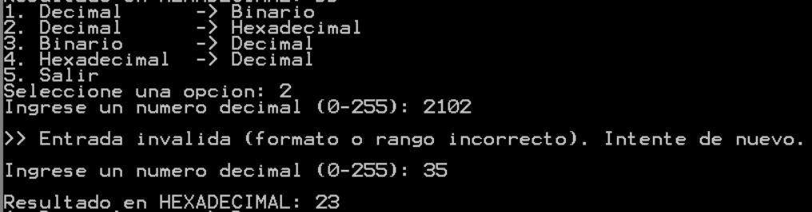
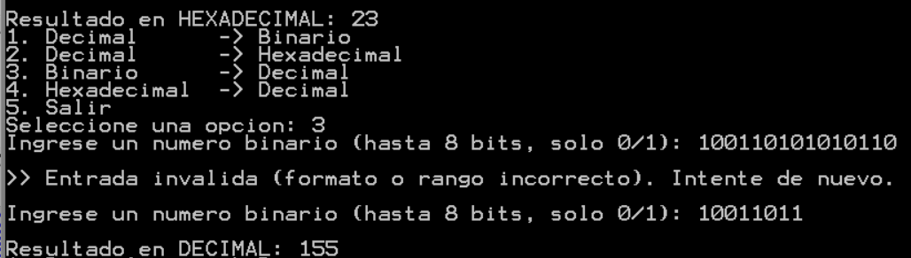
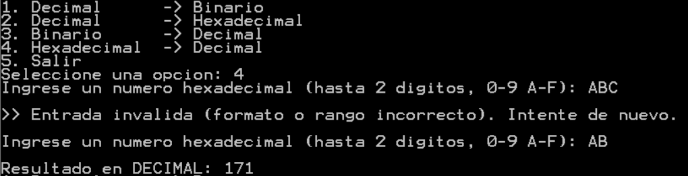
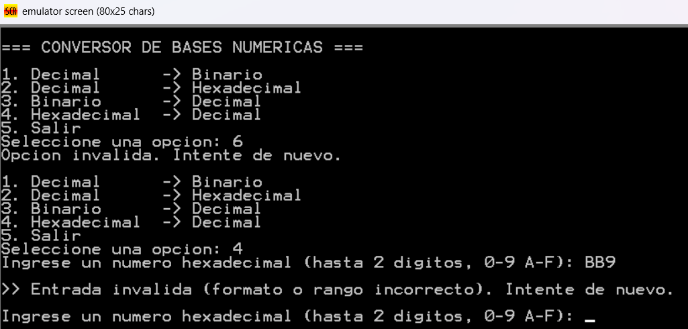
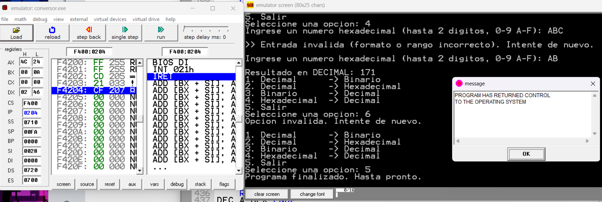

# 🔢 Conversor de Bases Numéricas en Assembly (x86 de 16 bits)

Programa interactivo escrito en **Assembly x86 de 16 bits** para el emulador **emu8086**, que convierte números enteros positivos entre decimal, binario y hexadecimal. Proyecto de la materia **Organización de Computadores** en la **ESPOL** (PAO 1 2026).

## Integrantes

- Fátima Gabriela Torres Vera
- César Andrés Balladares Caicedo

## Conversiones soportadas

| Opción | Conversión | Entrada permitida |
|--------|------------|-------------------|
| 1 | Decimal → Binario | 0 a 255 (máx. 3 dígitos). Muestra 8 bits |
| 2 | Decimal → Hexadecimal | 0 a 255 (máx. 3 dígitos). Muestra 2 dígitos |
| 3 | Binario → Decimal | Solo `0` y `1`, hasta 8 bits |
| 4 | Hexadecimal → Decimal | `0-9`, `A-F`, `a-f`, hasta 2 dígitos |
| 5 | Salir | — |

Cada resultado se imprime con una etiqueta que indica la base de salida (por ejemplo, `Resultado en BINARIO: 11010100`) y, al terminar, el programa vuelve al menú principal.

## Cómo ejecutarlo

1. Abrir **emu8086**.
2. Cargar el archivo `conversor.asm`.
3. Pulsar **Compile** y luego **Emulate** (o **Run**, según la versión).
4. Elegir una opción del 1 al 5 y presionar Enter.
5. Ingresar el valor según la base indicada. El programa vuelve al menú después de cada conversión; con la opción 5 termina.

## Validación de entrada

El programa nunca se cierra por un dato incorrecto. Toda la entrada se lee como cadena con `INT 21h` (función `0Ah`) y se valida carácter por carácter según la base activa. Si hay un símbolo inválido, una longitud excesiva o un decimal fuera de 0–255, se muestra un mensaje de error y se vuelve a pedir el dato.

## Estructura del código

El código está dividido en procedimientos (`PROC`/`ENDP`), cada uno documentado con su objetivo y los registros que modifica:

| Procedimiento | Instrucciones clave | Función |
|---------------|--------------------|---------|
| `MENU_PRINCIPAL` | `INT 21h (09h, 0Ah)` | Muestra el menú y lee la opción elegida |
| `LEER_NUMERO` | `INT 21h (0Ah)`, `CMP` | Lee la cadena, la valida según la base y obtiene su valor |
| `DEC_A_BIN` | `SHR`, `AND` | Convierte 0–255 a binario de 8 bits |
| `DEC_A_HEX` | `SHR`, `AND` | Convierte 0–255 a hexadecimal de 2 dígitos |
| `BIN_A_DEC` / `HEX_A_DEC` | `CALL` | Muestran en decimal el valor ya interpretado |
| `NUM_A_CADENA_DEC` | `DIV`, `PUSH`/`POP` | Extrae dígitos por resto y usa la pila para invertir su orden |
| `MOSTRAR_RESULTADO` | `INT 21h (09h)` | Imprime la etiqueta y el resultado |
| `MOSTRAR_ERROR` | `INT 21h (09h)` | Imprime el mensaje de entrada inválida |

## Capturas de ejecución

**Menú principal**



**Decimal → Binario**



**Decimal → Hexadecimal**



**Binario → Decimal**



**Hexadecimal → Decimal**



**Manejo de entrada inválida**



**Salir**



## Estructura del repositorio

```
conversor-bases-assembly/
├── conversor.asm                      # Código fuente
├── docs/
│   └── Informe_Proyecto_Assembly.pdf  # Informe del proyecto
├── capturas/                          # Capturas de la ejecución
├── .gitignore
└── README.md
```

## Tecnologías

Assembly x86 (16 bits) · emu8086 · interrupciones DOS (`INT 21h`)
